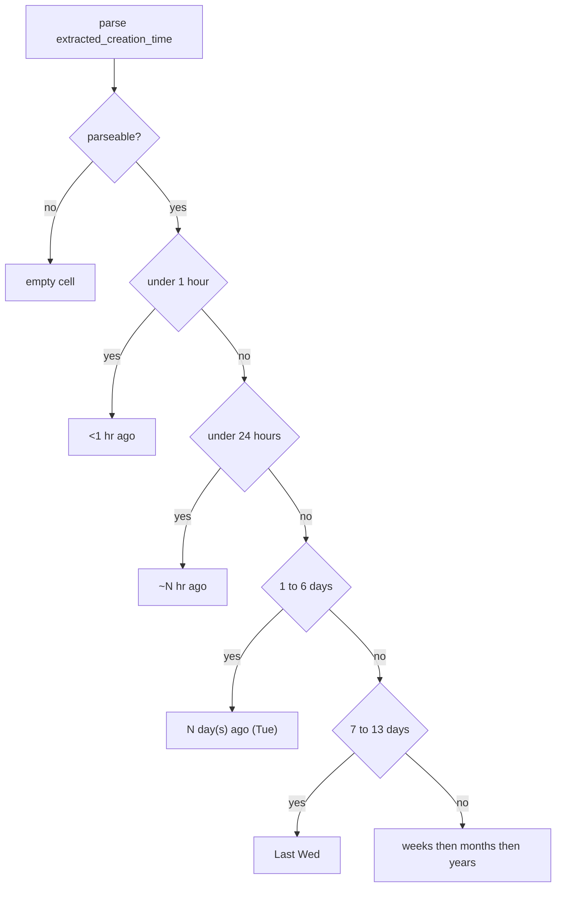

# Add Ago column next to Created

The recordings table is driven by [`scripts/gui/table_model.py`](scripts/gui/table_model.py). Created is already parsed (`parse_created_datetime`) and formatted for display (`format_created_display`). Ago will reuse that timestamp and will **not** be written into filelist CSVs (those are saved from `get_dataframe()` in [`scripts/gui/main_window.py`](scripts/gui/main_window.py)).

## Column wiring

In [`scripts/gui/table_model.py`](scripts/gui/table_model.py):

- Insert `"ago"` into `DISPLAY_COLUMNS` immediately after `"extracted_creation_time"`.
- Add `"ago": "Ago"` to `COLUMN_HEADERS`.
- Treat `ago` as virtual: do **not** create/fill an `ago` DataFrame column in `set_dataframe` / `upsert_row`.
- In `data()`:
  - **DisplayRole:** format from the row’s `extracted_creation_time` via a new `format_created_ago()`.
  - **UserRole:** same sortable key as Created (`YYYY-MM-DD HH:MM:SS`) so clicking Ago sorts chronologically.
  - **ToolTipRole:** the same absolute timestamp tooltip as Created.
- In `RecordingFilterProxy.lessThan`, apply the existing Created empty-last datetime sort to **both** `extracted_creation_time` and `ago`.

Default sort stays on Created ([`_sort_table_by_created_newest_first`](scripts/gui/main_window.py)); no change needed there. Column auto-size already covers new columns.

## Relative string ladder

Add `format_created_ago(value, now=None)` next to `format_created_display`. Empty/unparseable → `""`. Optional `now` keeps tests deterministic.

Elapsed time from `now` (naive local, same as Created parsing):

- **&lt; 1 hour:** `<1 hr ago` (also used for tiny future clock-skew)
- **&lt; 24 hours:** `~N hr ago` (`N` = rounded hours, minimum 1)
- **1–6 calendar days:** `1 day ago (Tue)` / `2 days ago (Mon)` (singular `day` for 1)
- **7–13 days:** `Last Wed` (`%a` weekday of the recording)
- **2–7 weeks:** `N weeks ago` (`N = max(2, round(days / 7))`)
- **older, &lt; 2 years:** `N months ago` (`N = max(2, round(days / 30))`)
- **2+ years:** `N years ago`

## Live refresh

Ago is now-relative, so stale strings would linger if the window stays open. In [`scripts/gui/main_window.py`](scripts/gui/main_window.py), add a 60s `QTimer` that emits `dataChanged` for the Ago column only (no DataFrame reset, no re-sort).

## Tests

Extend [`tests/test_table_job_state.py`](tests/test_table_job_state.py) (or a small adjacent test module):

- Unit cases for `format_created_ago` with a frozen `now` covering each ladder bucket, empty input, and clock-skew future.
- Table: Ago display sits next to Created; sorting Ago descending matches Created’s newest-first / empty-last behavior.
