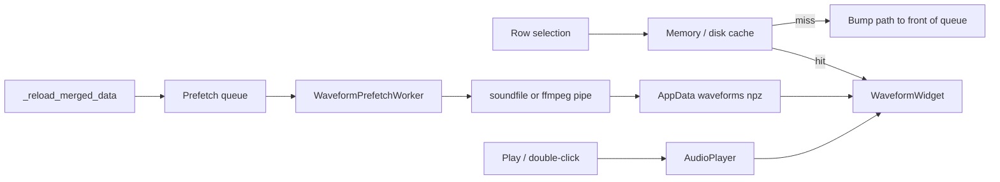

# Precompute and cache waveforms

Today peaks are computed only after `AudioPlayer.load()`, from the playback `decode_path` (often a full ffmpeg WAV). That is why the viewer stays empty until you play, and why `.mkv` peak extract is too expensive to run for every file.

Change the model: **selection shows the waveform; play still loads audio**. Peaks come from the original `full_path` via a cheap downsample, then a disk cache.



## Peak extract without a full WAV

Extend [`scripts/gui/waveform_widget.py`](scripts/gui/waveform_widget.py) (or a small sibling `waveform_cache.py`):

- Keep `downsample_peaks()` for files libsndfile can open with a finite frame count (same as `_try_open_soundfile`).
- For `.mkv` / `.mp4` / failed native open: stream **low-rate mono** from ffmpeg, never write `arm_playback_*.wav`:

```
ffmpeg -nostdin -hide_banner -i SOURCE -vn -ac 1 -ar 8000 -f f32le pipe:1
```

Chunk the pipe, bin min/max into `DEFAULT_N_BINS` (4096), duration = `n_samples / 8000`. Cancel between chunks. This is the only way precomputing dozens of hour-long videos stays feasible.

## Cache

Store under Qt cache dir (org/app already set in `main()`):

`QStandardPaths.CacheLocation / waveforms / <sha1(resolved-path)>.npz`

Each npz: `mins`, `maxs`, `duration`, `mtime_ns`, `size`, `n_bins`, `version`. Hit only if source still exists and mtime+size match. In-memory dict in front of disk for instant re-selection.

Do **not** write sidecars into recording folders or filelist CSVs.

## Background worker

Replace the one-shot `WaveformPeaksWorker` used only on play with a long-lived `WaveformPrefetchWorker` (same QThread style as [`discover_worker.py`](scripts/gui/discover_worker.py)):

- Queue of source paths; `request_cancel()` on quit/reload.
- Skip paths with a valid cache (fast).
- `prioritize(path)` moves a path to the front (mutex) so a newly selected file computes next.
- `peaks_ready(str_path, mins, maxs, duration)` / occasional progress (`Waveforms 12/80`).
- `QThread.Priority.LowestPriority`. Do not start while a transcribe is running (same guard as `_start_transcript_discovery`); resume after transcribe completes by calling `_start_waveform_prefetch()` again.

Start/rebuild the queue from `_reload_merged_data` (all `full_path`s in the merged table) and enqueue new paths from `_on_watch_file_ready`.

## Main window wiring

In [`scripts/gui/main_window.py`](scripts/gui/main_window.py):

- **`_on_selection_changed`**: resolve `full_path`; if cached, `set_peaks` immediately; else `set_loading()` + `prioritize(path)`. Do not call `player.load()`.
- **Play / double-click**: keep current `AudioPlayer` load+play. If peaks are already shown for that path, do **not** `set_loading()` / restart extract. Drive the playhead from `position_changed` as now.
- Empty state: `Select a recording` (not “double-click to play”).
- Waveform seek with no loaded player: no-op until play (seek still needs the SoundFile). Optional later: load-then-seek.
- `closeEvent`: stop the prefetch worker before `player.cleanup()`.

## Tests

Extend [`tests/test_waveform_widget.py`](tests/test_waveform_widget.py):

- Disk cache hit / miss / stale mtime recomputes.
- Native WAV extract does not invoke ffmpeg.
- Garbage `.mkv` extract fails without counting as cached.
- `prioritize` processes the bumped path before the rest of the queue (short synthetic WAVs).