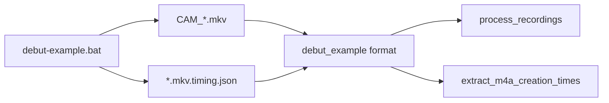

# Debut-example recordings format

## Context

[`scripts/debut-example.bat`](c:/Users/pho/repos/EmotivEpoc/ACTIVE_DEV/continuous_video_recorder/scripts/debut-example.bat) runs `uv run debut-example` → [`examples/debut_example.py`](c:/Users/pho/repos/EmotivEpoc/ACTIVE_DEV/continuous_video_recorder/examples/debut_example.py) with [`config_webcam_debut.yaml`](c:/Users/pho/repos/EmotivEpoc/ACTIVE_DEV/continuous_video_recorder/config_webcam_debut.yaml).

**Actual outputs:**
- Media: `CAM_YYYY-MM-DDTHHMMSS.mkv` (from `filename_format: "CAM_%YYYY%-%MM%-%DD%T%HH%%MIN%%SS%"`)
- Sidecar: `CAM_....mkv.timing.json` via `sidecar_path_for()` in [`timing_sidecar.py`](c:/Users/pho/repos/EmotivEpoc/ACTIVE_DEV/continuous_video_recorder/src/timing_sidecar.py) (`path.with_suffix(path.suffix + ".timing.json")`)
- Default dir: `H:/ScreenRecordings/REC_continuous_video_recorder`

**Existing formats (do not confuse):**
- `debut` = NCH Debut app files (`Debut_YYYY-MM-DDTHHMMSS`) — unrelated
- `rec_continuous` = thin `CAM_*` matcher only — no sidecar/filename creation time; default still `I:/...`

## Approach

Add format id **`debut_example`** as the canonical CAM_* + timing-sidecar format. Keep **`rec_continuous`** as a thin subclass/alias (same matching, same helpers) so existing CLI/GUI/`--format rec_continuous` keep working. Register only `debut_example` in `detect_format` order so auto-detect returns the new id.



## Implementation

### 1. New module [`whisper_timestamped/recording_formats/debut_example.py`](c:/Users/pho/repos/EmotivEpoc/ACTIVE_DEV/whisper-timestamped/whisper_timestamped/recording_formats/debut_example.py)

- `id="debut_example"`, `label="Debut Example (continuous_video_recorder)"`
- `media_extensions=(".mkv", ".mp4")`, `input_mode="directory"`
- Defaults aligned with YAML:
  - `default_recordings_dir=H:/ScreenRecordings/REC_continuous_video_recorder`
  - `default_output_dir=.../transcriptions`
  - `default_filelists_dir=.../filelists`
  - `filelist_name_prefix="debut_example"`
- `matches_file`: stem matches `^CAM_\d{4}-\d{2}-\d{2}T\d{6}` (same as today’s `rec_continuous`)
- Helpers:
  - `sidecar_path_for(path)` → `path.with_suffix(path.suffix + ".timing.json")` (mirror recorder)
  - `parse_cam_filename(path)` → datetime from stem
  - `read_timing_sidecar(path)` → optional JSON dict
- `extract_creation_time(path, tz_name=...)`:
  1. Prefer sidecar `wall_clock_start_unix` → local `YYYY-MM-DD HH:MM:SS` via existing `utc_to_local_str` in [`base.py`](c:/Users/pho/repos/EmotivEpoc/ACTIVE_DEV/whisper-timestamped/whisper_timestamped/recording_formats/base.py)
  2. Else filename datetime string (same no-TZ style as Just Press Record / VoiceMemos)
- `extra_row_fields` / `extra_filelist_columns`: `timing_sidecar`, `segment_index`, `duration_perf_seconds`, `lsl_local_clock_start` when sidecar present
- In `build_filelist_rows`, when `extract_creation_time` returns a value, use it for the `creation_time` column (more accurate than FS birth time for these segments)

### 2. Thin alias [`rec_continuous.py`](c:/Users/pho/repos/EmotivEpoc/ACTIVE_DEV/whisper-timestamped/whisper_timestamped/recording_formats/rec_continuous.py)

- Reimplement as subclass of `DebutExampleFormat` that only overrides `id="rec_continuous"`, `label`, and `filelist_name_prefix` (and optionally keeps the old `I:/` default dir if you want path-compat — **chosen default: share the H:/ path** so both ids point at current debut-example output)

### 3. Registry / exports

- [`registry.py`](c:/Users/pho/repos/EmotivEpoc/ACTIVE_DEV/whisper-timestamped/whisper_timestamped/recording_formats/registry.py): put `DebutExampleFormat()` in `_DETECT_ORDER` (before or replacing the CAM slot); include both ids in `FORMATS` (detect uses only `debut_example`)
- [`__init__.py`](c:/Users/pho/repos/EmotivEpoc/ACTIVE_DEV/whisper-timestamped/whisper_timestamped/recording_formats/__init__.py): export `DebutExampleFormat` and any public parse helpers

### 4. Tests [`tests/test_recording_formats.py`](c:/Users/pho/repos/EmotivEpoc/ACTIVE_DEV/whisper-timestamped/tests/test_recording_formats.py)

- Known ids include `debut_example`
- `matches_file` for `CAM_*.mkv` / reject `Debut_*`
- Sidecar-preferred creation time (temp dir + synthetic `.mkv.timing.json` with `wall_clock_start_unix`)
- Filename fallback when sidecar missing
- `detect_format` on a folder of CAM files → `debut_example`
- `get_format("rec_continuous")` still works and matches the same files

### 5. Small call-site / docs touch-ups

- [`README_RUNNING_CLI.md`](c:/Users/pho/repos/EmotivEpoc/ACTIVE_DEV/whisper-timestamped/README_RUNNING_CLI.md): add `debut_example` to the format list
- [`scripts/gui/main_window.py`](c:/Users/pho/repos/EmotivEpoc/ACTIVE_DEV/whisper-timestamped/scripts/gui/main_window.py) `_infer_format_id`: recognize `debut_example` in CSV names

## Usage after change

```bash
python scripts/process_recordings.py --format debut_example
# or with an explicit dir:
python scripts/process_recordings.py -f debut_example --recordings_dir "H:/ScreenRecordings/REC_continuous_video_recorder"
```

`--format rec_continuous` remains valid (alias).

## Out of scope

- Changing continuous_video_recorder naming or sidecar schema
- Changing NCH `debut` format behavior
- Wiring absolute transcript↔LSL remapping inside the Whisper loop (sidecar fields are exposed in filelists for later alignment)
