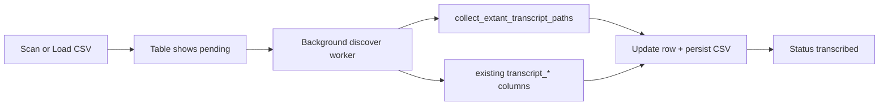

# Discover transcribed status on load

## Why this happens today

`compute_status()` in [`scripts/gui/table_model.py`](c:\Users\pho\repos\EmotivEpoc\ACTIVE_DEV\whisper-timestamped\scripts\gui\table_model.py) only marks a row transcribed when `transcript_txt` or `transcript_json` is already filled in the filelist CSV. Those columns are written only after `process_recordings` / `TranscribeWorker` finishes.

Scan then throws that evidence away: [`ensure_filelist_csv()`](c:\Users\pho\repos\EmotivEpoc\ACTIVE_DEV\whisper-timestamped\whisper_timestamped\recording_formats\base.py) rewrites the CSV with media metadata only, so a rescan (or a CSV that never went through the GUI transcribe path) shows everything as pending even when `.txt` / `.words.json` already exist in `transcriptions/`.

CLI `process_recordings` already knows how to detect those files via `find_extant_output_files` / `collect_extant_transcript_paths` in [`scripts/process_recordings.py`](c:\Users\pho\repos\EmotivEpoc\ACTIVE_DEV\whisper-timestamped\scripts\process_recordings.py). The GUI never runs that check on discovery.

## 1. Extract lightweight transcript-output helpers

Move filesystem helpers out of [`scripts/process_recordings.py`](c:\Users\pho\repos\EmotivEpoc\ACTIVE_DEV\whisper-timestamped\scripts\process_recordings.py) into a new torch-free module [`scripts/transcript_outputs.py`](c:\Users\pho\repos\EmotivEpoc\ACTIVE_DEV\whisper-timestamped\scripts\transcript_outputs.py) so the GUI can probe disk without importing whisper/torch:

- `_TRANSCRIPT_OUTPUT_SPECS`, `_transcript_column_for_key`
- `collect_extant_transcript_paths`, `find_extant_output_files`, `flatten_write_results_to_transcript_cols`
- `_discard_transcript_outputs` (also delete the new params sidecar)

`process_recordings` keeps importing these from the new module.

## 2. Background discovery after every table load

Add [`scripts/gui/discover_worker.py`](c:\Users\pho\repos\EmotivEpoc\ACTIVE_DEV\whisper-timestamped\scripts\gui\discover_worker.py) (`QThread`), started from [`MainWindow._reload_merged_data()`](c:\Users\pho\repos\EmotivEpoc\ACTIVE_DEV\whisper-timestamped\scripts\gui\main_window.py) after scan, Load CSV, and startup restore.

Per row:

1. If any `transcript_*` path already exists on disk, keep it (status variables).
2. Else search candidate output dirs with `collect_extant_transcript_paths(output_dir, base_name)` using the same basename rules as `TranscribeWorker` (`name` stem, else `full_path` stem).
3. If outputs exist, emit `{transcript_* paths, param columns}` and mark transcribed.

Candidate dirs (deduped, existing dirs only):

- parent of any already-set `transcript_*` path
- format `default_output_dir` from `format_id`
- CSV-derived `transcriptions/` (same rule as `_start_transcription`: `filelists/` sibling, else beside the CSV)
- last-used `transcribe_output_dir` from prefs

Emit row updates incrementally so the table flips from pending to transcribed without blocking. Persist each affected source CSV once at the end (not per row). Cancel/restart the worker if the user scans or loads again.

Also align `compute_status()` with `has_any_transcript()` so any non-empty `transcript_*` path counts, not only txt/json.

## 3. Preserve filelist transcript columns across rescan

After `extract_for_csv` in [`ScanWorker`](c:\Users\pho\repos\EmotivEpoc\ACTIVE_DEV\whisper-timestamped\scripts\gui\scan_worker.py), if the CSV already existed, merge previous `transcript_*` and param columns onto matching rows by `full_path` then `name`. Scan still rebuilds media metadata; it just stops wiping known transcription status. Disk discovery in step 2 covers rows the old CSV did not know about.

## 4. Save transcription parameters with results

When `write_results` / `process_recordings` succeed, persist the run settings with the outputs:

Sidecar `{base_name}.params.json` next to `.words.json` / `.txt`, and a `transcription_params` object inside `.words.json` (the GUI JSON loader only reads `segments` / `language`, so the extra key is safe).

Params to store:

- `backend`, `model_name`, `crisper_mode`, `crisper_runtime`
- `language` (currently hardcoded `"en"`), `vad` (`"silero"`), `remove_empty_words`
- `device` (`cuda`/`cpu`)

Also write filelist columns: `transcript_params` (sidecar path), `transcript_backend`, `transcript_model`, `transcript_crisper_mode`.

`TranscribeWorker.file_completed` should include those columns so `_on_file_transcribed` persists them. On skip-if-outputs-exist, copy params from an existing sidecar / `.words.json` if present. `_discard_transcript_outputs` must remove the sidecar on force-abort.

No new table column is required; optional tooltip on the transcript cell can show backend/model when present.

## 5. Tests

Add a small unit test file (no GUI/torch) covering:

- `collect_extant_transcript_paths` against a temp output dir
- params sidecar write/read
- candidate-dir resolution / merge of prior `transcript_*` columns on a rebuilt filelist
