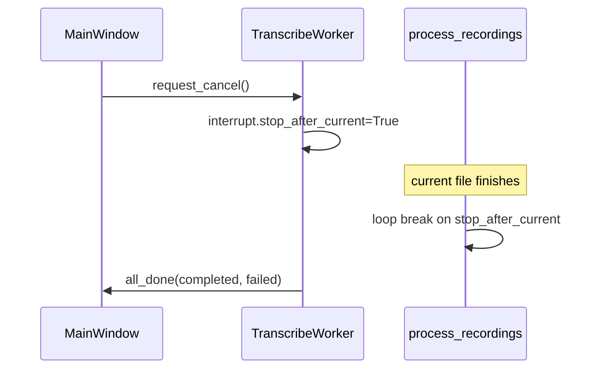

# GUI Cancel Transcription Queue

## Behavior

Cancel is a **soft-stop** (same as CLI Ctrl+C once): finish the file currently in `whisper.transcribe`, persist its outputs, then skip remaining queued jobs. No `QThread.terminate()` / force-kill of torch.

## Changes

### 1. Injectable interrupt in [`scripts/process_recordings.py`](scripts/process_recordings.py)

- Add optional `interrupt: Optional[_GracefulInterruptState] = None` to `process_recordings(...)`.
- If `None`, keep current behavior: create a fresh `_GracefulInterruptState()`, set `output_dir`, `install()` SIGINT (no-op in QThread).
- If provided (GUI), reuse that instance, set `output_dir`, still call `install()`/`restore()` for CLI safety when used from main thread.
- Soft-stop log text already at the job loop (~564–567) works as-is; optionally soften “after Ctrl+C” wording to “after cancel” for both CLI and GUI.

### 2. Wire cancel in [`scripts/gui/transcribe_worker.py`](scripts/gui/transcribe_worker.py)

- Create `_GracefulInterruptState` in `__init__` (or just before `process_recordings`).
- `request_cancel()`: set `_cancel_requested = True` **and** `self._interrupt.stop_after_current = True`; emit a log line via `output_line` (“Cancel requested — finishing current file, then stopping…”).
- Pass `interrupt=self._interrupt` into `process_recordings(...)`.

### 3. Toolbar Cancel in [`scripts/gui/main_window.py`](scripts/gui/main_window.py)

- Add `Cancel` button immediately after **Transcribe All Pending** (~144), initially `setEnabled(False)`.
- `_on_cancel_transcription` → if worker running, call `request_cancel()`, disable Cancel (avoid double-press spam), set status to “Cancelling…”.
- In `_start_transcription`: enable Cancel when worker starts (with Transcribe buttons disabled).
- In `_on_transcription_done` / `_on_transcription_error`: disable Cancel; re-enable Transcribe buttons (existing).
- Status text after soft-stop can stay as the existing “Transcription complete: N succeeded…” plus a log line from the worker/process_recordings soft-stop message.

`closeEvent` already calls `request_cancel()`; once wired, window close will also soft-stop the queue correctly (still may wait up to the current file + `wait(5000)`).

## Out of scope

- Force-abort of in-flight Whisper (would need KeyboardInterrupt / partial discard path; harder and riskier with CUDA).
- Fixing the separate GUI `crisper_mode="clean"` → ValueError mismatch (visible in the screenshot log; not required for Cancel).
