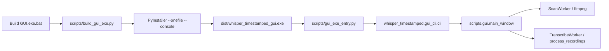

# Single-file GUI executable

The GUI already runs in-process (`TranscribeWorker` calls `process_recordings()`), so the exe must freeze the GUI **and** the Whisper/Crisper stack, not a thin launcher. You chose **onefile + console** so startup and transcribe errors stay visible.

Existing [`scripts/build_exe.py`](c:\Users\pho\repos\EmotivEpoc\ACTIVE_DEV\whisper-timestamped\scripts\build_exe.py) targets CLI `process_recordings.py` and is not suitable (wrong entry, `--windowed`, incomplete/incorrect `--add-data`). Leave it; add a dedicated GUI builder.



## Frozen entry

[`whisper_timestamped/gui_cli.py`](c:\Users\pho\repos\EmotivEpoc\ACTIVE_DEV\whisper-timestamped\whisper_timestamped\gui_cli.py) currently requires `scripts/gui` on disk and will fail inside a frozen app.

- Call `multiprocessing.freeze_support()` first (required on Windows onefile).
- Skip the source-checkout directory check when `getattr(sys, "frozen", False)`.
- Keep the PyQt6 error path for non-frozen `uv run`.

Add a tiny Analysis script [`scripts/gui_exe_entry.py`](c:\Users\pho\repos\EmotivEpoc\ACTIVE_DEV\whisper-timestamped\scripts\gui_exe_entry.py):

```python
from whisper_timestamped.gui_cli import cli
if __name__ == "__main__":
    cli()
```

Add empty package markers so PyInstaller can collect namespace-ish imports:

- [`scripts/__init__.py`](c:\Users\pho\repos\EmotivEpoc\ACTIVE_DEV\whisper-timestamped\scripts\__init__.py)
- [`scripts/iOSWhisperAppHelpers/__init__.py`](c:\Users\pho\repos\EmotivEpoc\ACTIVE_DEV\whisper-timestamped\scripts\iOSWhisperAppHelpers\__init__.py)

## Builder

New [`scripts/build_gui_exe.py`](c:\Users\pho\repos\EmotivEpoc\ACTIVE_DEV\whisper-timestamped\scripts\build_gui_exe.py) (same style as the old CLI builder) runs PyInstaller from the repo root:

- `--onefile --console --noconfirm --clean`
- `--name whisper_timestamped_gui`
- `--paths` repo root
- `--collect-all PyQt6` (Qt platform plugins)
- `--collect-submodules` for `scripts`, `scripts.gui`, `whisper_timestamped`, `whisper_timestamped.recording_formats`, `whisper_timestamped.crisperwhisper`
- Hidden imports the analysis often misses: `scripts.process_recordings`, `scripts.transcribe_queue`, `scripts.transcript_outputs`, `scripts.iOSWhisperAppHelpers.extract_m4a_creation_times`, `sounddevice`, `soundfile`
- `--collect-all torch` / `torchaudio` so CUDA DLLs from this env actually ship (this is what makes the exe multi-GB)
- `--copy-metadata` for `openai-whisper`, `transformers`, `huggingface-hub` as needed
- `dist/` / `build/` already gitignored; do not commit a `.spec`

Do **not** bundle Whisper/HF weights; they stay in the user cache. Do **not** bundle `ffmpeg`/`ffprobe`; scan, playback fallback, and decode still expect them on PATH (same as the source GUI).

`sounddevice` is imported by [`scripts/gui/audio_player.py`](c:\Users\pho\repos\EmotivEpoc\ACTIVE_DEV\whisper-timestamped\scripts\gui\audio_player.py) but only listed under the `live` extra. Add `sounddevice>=0.4.6` to the `gui` extra in [`pyproject.toml`](c:\Users\pho\repos\EmotivEpoc\ACTIVE_DEV\whisper-timestamped\pyproject.toml).

## Launch / docs

- New `Build GUI.exe.bat` at repo root: `uv run --extra gui python scripts/build_gui_exe.py`
- Document in [`README_RUNNING_CLI.md`](c:\Users\pho\repos\EmotivEpoc\ACTIVE_DEV\whisper-timestamped\README_RUNNING_CLI.md): build command, output path, console-on-purpose, size/startup warning, ffmpeg on PATH, models downloaded on first transcribe.

Verification (after you approve implementation): run the builder, confirm `dist/whisper_timestamped_gui.exe` exists, launch it and check the window + console appear. Full GPU transcribe smoke is optional and slow.