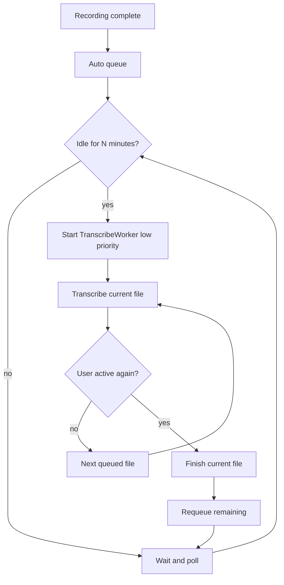

# Low-impact auto-transcribe

Auto-transcribe today starts as soon as a recording is complete, on a normal-priority in-process [`TranscribeWorker`](c:/Users/pho/repos/EmotivEpoc/ACTIVE_DEV/whisper-timestamped/scripts/gui/transcribe_worker.py) that calls [`process_recordings()`](c:/Users/pho/repos/EmotivEpoc/ACTIVE_DEV/whisper-timestamped/scripts/process_recordings.py). CUDA/ffmpeg therefore compete with whatever else is on the machine.

**Scope:** tray auto-queue only. Manual Transcribe Selected / Transcribe All keep current speed and priority.

**Stay in-process.** Do not split inference into a subprocess (same CUDA-in-one-process constraint as the tray watcher). GPU kernels will still run at full device speed **during the current file**; the win is not starting more work while you are using the computer, plus cheaper CPU around that work.

## Settings (Watch Folders)

Add a **Background processing** group to [`WatchFoldersDialog`](c:/Users/pho/repos/EmotivEpoc/ACTIVE_DEV/whisper-timestamped/scripts/gui/dialogs.py), above the folder table. Persist via [`preferences.py`](c:/Users/pho/repos/EmotivEpoc/ACTIVE_DEV/whisper-timestamped/scripts/gui/preferences.py):

- `watch/run_when`: `"idle"` (default) or `"always"`
- `watch/idle_seconds`: default `300` (combo: 1 / 2 / 5 / 10 / 15 min)
- `watch/low_priority`: default `True`

Controls:
- Radio: **Whenever files are ready** vs **When this computer is idle**
- Idle delay combo, enabled only in idle mode
- Checkbox: **Run auto-transcribe at low CPU priority**

Tray tooltip already shows auto on/paused; extend to `waiting for idle · N queued` when the gate is holding work.

## Idle gate

New torch-free [`scripts/gui/idle.py`](c:/Users/pho/repos/EmotivEpoc/ACTIVE_DEV/whisper-timestamped/scripts/gui/idle.py):

- Windows: `GetLastInputInfo` via `ctypes` (keyboard/mouse idle for the session). A locked session counts as idle.
- Non-Windows fallback: treat as idle so drain still works (this app is Windows-first).

Pure helper for tests: `should_start_auto(*, watch_enabled, worker_running, run_when, idle_seconds, idle_for) -> bool`.

In [`main_window.py`](c:/Users/pho/repos/EmotivEpoc/ACTIVE_DEV/whisper-timestamped/scripts/gui/main_window.py):

- 5s `QTimer` tick
- [`_drain_auto_queue`](c:/Users/pho/repos/EmotivEpoc/ACTIVE_DEV/whisper-timestamped/scripts/gui/main_window.py) returns without starting if `run_when == "idle"` and last input is younger than the threshold
- If an **auto** worker is running and the user becomes active: `request_pause()` once (not Cancel)
- Pause reuses existing `stop_after_current` **without** adding remaining rows to `skip_indices` (so they are not cancelled)
- On `all_done`, leftover `queued` df indices go back onto `_auto_queue`; drain waits for idle again

Cannot abort CUDA mid-file. Current file always finishes; only later files wait.

## Low CPU priority (auto jobs only)

When `_transcribe_origin == "auto"` and `watch/low_priority`:

- `QThread.Priority.LowestPriority` on the worker (after `start()`)
- In `TranscribeWorker.run()`, before `process_recordings`: `torch.set_num_threads(1)` and `torch.set_num_interop_threads(1)` (restore is unnecessary; the next manual job can set threads back if we store previous values and restore in a `finally`)
- Windows: `SetThreadPriority(GetCurrentThread(), THREAD_PRIORITY_LOWEST)` on the worker thread. **Do not** `SetPriorityClass` on the whole GUI process.

Manual jobs keep default thread priority and default torch thread counts.

ffmpeg spawned by `whisper.load_audio` still inherits process priority; that is accepted for v1 (thread niceness still helps Python/VAD/CPU decode setup).

## Worker API

[`TranscribeWorker.request_pause()`](c:/Users/pho/repos/EmotivEpoc/ACTIVE_DEV/whisper-timestamped/scripts/gui/transcribe_worker.py): set `stop_after_current`, log `User activity — finishing current file, then waiting for idle…`. Distinct from `request_cancel()` which skip-marks remaining rows.

No change to [`job_loop_action`](c:/Users/pho/repos/EmotivEpoc/ACTIVE_DEV/whisper-timestamped/scripts/transcribe_queue.py) beyond tests that pause == stop-without-skip.

## Tests (no GUI/torch)

Add [`tests/test_idle_gate.py`](c:/Users/pho/repos/EmotivEpoc/ACTIVE_DEV/whisper-timestamped/tests/test_idle_gate.py):

- `should_start_auto` false when not idle / worker running / watch off; true when idle or `run_when=always`
- Prefs round-trip of the three new keys (defaults: idle, 300s, low_priority on)
- Pause vs cancel: leftover indices requeued vs skipped (small helper around leftover collection)

Follow [`end-for-loop-comments`](c:/Users/pho/.cursor/skills/end-for-loop-comments/SKILL.md) on new/edited Python `for` loops.

## Out of scope

- Subprocess isolation / killing CUDA mid-file
- GPU clocks, CUDA stream priority, AC-power-only
- Changing manual Transcribe
- Detecting “busy” without input (e.g. watching video with no mouse) — idle means no keyboard/mouse for N minutes
