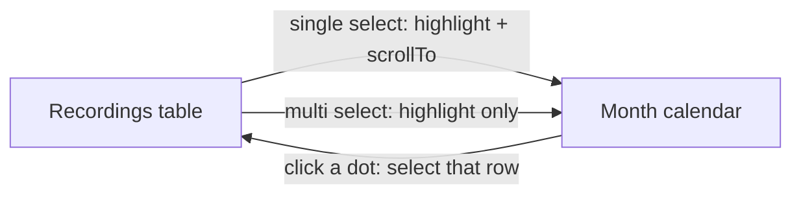

# Monthly recordings calendar

## Placement

Keep the existing [Transcript Preview dock](c:/Users/pho/repos/EmotivEpoc/ACTIVE_DEV/whisper-timestamped/scripts/gui/main_window.py) and stack a new **Calendar** dock above it in the same right column:

- New `QDockWidget("Calendar")` in `RightDockWidgetArea`
- `splitDockWidget(calendar, preview, Qt.Vertical)` so they share the column
- Default calendar height ~240px (small); preview keeps the remaining stretch
- Same dock features as preview (closable/movable)

## Widget

New [scripts/gui/calendar_view.py](c:/Users/pho/repos/EmotivEpoc/ACTIVE_DEV/whisper-timestamped/scripts/gui/calendar_view.py): a `QScrollArea` of **month grids for every month that has at least one visible recording** (skip empty months so the scroller stays short).

Each month: header (`October 2026`), weekday row from locale first-day-of-week, 6x7 day cells. Each recording that day is a small circular badge with its **1-based chronological index** that day (by `extracted_creation_time`, then `df_index`). Hover tooltip: name + formatted time.

Do **not** use `QCalendarWidget` — it cannot host per-recording clickable numbered dots. Day cells are widgets; dots are tiny buttons so `ensureWidgetVisible` can target one recording.

Style dots with existing [style.py](c:/Users/pho/repos/EmotivEpoc/ACTIVE_DEV/whisper-timestamped/scripts/gui/style.py) colors: fill from `STATUS_COLORS` (pending/transcribed/etc.), selected ring/background from `_SELECTION_BG` / `_ACCENT` so they match table selection.

Recordings with unparseable `extracted_creation_time` are omitted.

## Data and filters

Calendar shows the **currently filtered table rows** (same set as the table), keyed by DataFrame index:

- Iterate `self._proxy.rowCount()`, `mapToSource`, `df_index_for_row` + `parse_created_datetime`
- Rebuild on `RecordingTableModel.data_changed_signal`, proxy `layoutChanged` / `modelReset` / `rowsInserted` / `rowsRemoved` (covers Load CSV, watcher upserts, and format/status/search/hide-dups filters)

Helper (testable, no widgets): group entries into `(year, month) -> date -> [CalendarEntry]`.

## Selection sync

Extend `_on_selection_changed` in [main_window.py](c:/Users/pho/repos/EmotivEpoc/ACTIVE_DEV/whisper-timestamped/scripts/gui/main_window.py):

- Collect selected `df_index` values via existing `_get_selected_source_rows` / `_visual_rows_to_df_indices`
- `calendar.set_selected(indices, scroll=len(indices) == 1)`
- **One row:** highlight that dot and `ensureWidgetVisible` (changes month into view if needed)
- **Several rows:** highlight all matching dots, **do not** scroll
- **None:** clear highlight

Calendar `dot_clicked(df_index)` → select that one table row (clear others), `scrollTo` the row, which already drives transcript preview. Guard with a `_syncing_selection` flag so calendar-driven table selection does not bounce back and scroll the calendar.

Clicking a dot is single-select only (no ctrl-add on the calendar).

## Tests

Add [tests/test_calendar_view.py](c:/Users/pho/repos/EmotivEpoc/ACTIVE_DEV/whisper-timestamped/tests/test_calendar_view.py) in the same QApplication style as [tests/test_table_job_state.py](c:/Users/pho/repos/EmotivEpoc/ACTIVE_DEV/whisper-timestamped/tests/test_table_job_state.py):

- Group/number by day (same-day order, undated dropped, empty months omitted)
- `set_selected(..., scroll=True)` vs `scroll=False` does not call `ensureWidgetVisible` on multi-select
- Follow existing `## END for ...` loop comments in new Python
