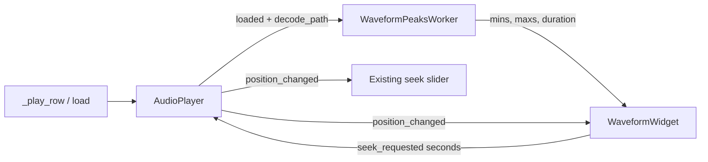

# Add waveform viewer above playback bar

There is **no maintained drop-in PyQt waveform + playback bar** that fits this app. Candidates fail for the same reasons: [wavesurfer.js](https://wavesurfer.xyz/) needs QtWebEngine; [pyqtgraph](https://www.pyqtgraph.org/) is a scientific plotter (extra GUI dep, axes/zoom chrome); [pyqt-music-player-widget](https://pypi.org/project/pyqt-music-player-widget/) is PyQt5/MP3-only; C++ Qt4 `WaveformWidget` and small GitHub toys would replace the working player and not handle `.m4a` / `.caf` / ffmpeg fallback.

**Recommendation:** keep [`scripts/gui/audio_player.py`](scripts/gui/audio_player.py) and the transport row; add a ~72px overview waveform above the slider, in the same QPainter style as [`scripts/gui/calendar_view.py`](scripts/gui/calendar_view.py). No new pip dependencies (numpy + soundfile + PyQt6 are already present). Out of scope for this pass: zoom/pan, spectrogram, word-timestamp overlays.



## Layout

In [`_build_playback_dock`](scripts/gui/main_window.py) insert `WaveformWidget` **above** the transport `QHBoxLayout`, still inside the Playback dock:

```
Playback dock
  WaveformWidget   (fixed height ~72px, click/drag to seek)
  ▶ ■  00:00  ====slider====  03:12  🔊
  Now playing: …
```

Keep the slider. Both scrubbers stay in sync via the existing `_is_seeking` flag so the 10 Hz position timer does not fight a drag.

Theme from [`scripts/gui/style.py`](scripts/gui/style.py): `_BG_WIDGET` fill, `_ACCENT` envelope, `_FG` playhead, `_FG_DIM` empty/loading text.

## Peak extraction (must not touch the live SoundFile)

`AudioPlayer` **streams** from one `soundfile.SoundFile` whose read pointer is owned by the sounddevice callback. Peak extraction must open a **second** `SoundFile` on the decoded path.

1. In `AudioPlayer.load()`, close any previous `_sf` (existing leak), then after a successful open emit a new `loaded` signal and expose `decode_path` (original file, or the ffmpeg temp WAV).
2. New [`scripts/gui/waveform_widget.py`](scripts/gui/waveform_widget.py):
   - `downsample_peaks(path, n_bins=4096) -> (mins, maxs, duration)` — chunked read (~64k frames), mix to mono, min/max per bin. Never `sf.read()` the whole file (Debut `.mkv` / Rec Continuous can be hours long).
   - `WaveformPeaksWorker(QThread)` — same pattern as [`scan_worker.py`](scripts/gui/scan_worker.py). Generation token so a stale job is ignored if the user loads another file mid-extract.
   - `WaveformWidget(QWidget)` — `set_peaks` / `set_position` / `set_loading` / `clear`; `seek_requested(float)` on click and drag. Paint a filled mirrored envelope (`QPolygonF`) plus a 1px playhead. Map `x / width * duration` to seconds.

## Main-window wiring

In [`scripts/gui/main_window.py`](scripts/gui/main_window.py):

- On `AudioPlayer.loaded`: `waveform.set_loading()`, start/replace the peaks worker with `decode_path`.
- On worker `finished`: `set_peaks` if the generation still matches.
- `_on_position_changed`: also `waveform.set_position(seconds)` unless seeking.
- Waveform `seek_requested` → `_player.seek` (set `_is_seeking` during drag, same as the slider).
- `_on_player_state_changed("stopped")`: playhead to 0; **do not** clear peaks (file is still loaded). Clear only when a new load starts or the player has no path.

## Tests

New [`tests/test_waveform_widget.py`](tests/test_waveform_widget.py), matching the QApplication pattern in [`tests/test_calendar_view.py`](tests/test_calendar_view.py):

- `downsample_peaks` on a synthetic WAV (known sine / silence / stereo) — bin count, duration, silence ≈ 0, sine extrema near ±1.
- Click at 25% width emits `seek_requested` ≈ `0.25 * duration`.
- Stale worker results are ignored (generation token).

No PyInstaller / `pyproject.toml` changes.