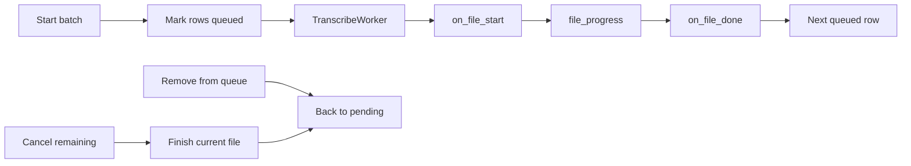

# Per-row transcription progress and queue cancel

Transcription is already sequential in one `TranscribeWorker`, but the table only flips pending → transcribed **after the whole batch**. In-file progress lives on stderr as tqdm (`unit="frames"`), so the GUI never sees it. Toolbar Cancel already soft-stops after the current file; queued rows cannot be removed today because the job list is baked into a temp CSV.



## UX

- **Queued:** distinct status icon + blue/purple row tint (not persisted to CSV).
- **Running:** same row shows a progress bar in the **Name** cell (accent fill + `42%`). Status icon switches to transcribing. Until the first tqdm tick, show `Starting…` rather than a fake 0%.
- **Completed:** existing green ✓ / transcribed tint, updated **as each file finishes**, not at batch end.
- **Cancel current / remaining:** same meaning as today’s toolbar Cancel — current file finishes, remaining queued rows return to pending immediately.
- **Cancel a queued row:** remove that file from the job list; the rest continues. Context menu plus a click on the status cell of a queued/transcribing row.

Toolbar Cancel stays. Status-bar text becomes `Transcribing 3/12 — CAM_….mkv 42%`. Failed files get a brief `failed` tint/tooltip, then stay pending so they can be retried. Skipped-because-outputs-exist still become transcribed.

`queued` / `transcribing` / `cancelling` are **runtime-only**. They never go into filelist CSVs (`_write_source_csv` already drops `status`).

**Pending filter** includes queued/transcribing/cancelling so those rows do not vanish mid-run.

## 1. Structured callbacks + skip set in `process_recordings`

In [`scripts/process_recordings.py`](c:\Users\pho\repos\EmotivEpoc\ACTIVE_DEV\whisper-timestamped\scripts\process_recordings.py):

- Add `skip_indices: set` on `_GracefulInterruptState` (checked at the top of the job loop next to `stop_after_current`).
- Optional callbacks: `on_file_start(row_index, base_name, i, n)`, `on_file_done(row_index, transcript_cols)`, `on_file_skip(row_index, reason)`, `on_file_error(row_index, message)`, `on_progress(fraction)`.
- Preserve GUI row identity: the temp CSV currently drops the DataFrame index (`to_csv(index=False)`), so callbacks would get `0..n-1`. Have the worker write `_arm_df_index` and use that as `row_index` in `jobs`.

Emit `on_file_done` live after write/skip-if-exists (including extant outputs). Count cancelled leftovers separately from real failures.

## 2. In-file progress from CrisperWhisper tqdm

Do **not** scrape stderr. Wrap updates in [`whisper_timestamped/crisperwhisper/longform/progress.py`](c:\Users\pho\repos\EmotivEpoc\ACTIVE_DEV\whisper-timestamped\whisper_timestamped\crisperwhisper\longform\progress.py):

- Thread-local `set_audio_progress_callback(fn)` so `pbar.update` reports `n/total` without threading a new arg through `whisper.transcribe` → Crisper → longform.
- Worker sets the callback on the QThread; the hook emits `file_progress` (Qt signal, thread-safe).
- openai-whisper backend: no ticks → keep the indeterminate `Starting…` bar until `on_file_done`. Terminal tqdm stays as-is.

## 3. Worker signals and per-row skip

[`scripts/gui/transcribe_worker.py`](c:\Users\pho\repos\EmotivEpoc\ACTIVE_DEV\whisper-timestamped\scripts\gui\transcribe_worker.py):

```python
file_started = pyqtSignal(int, str, int, int)  # df_index, name, i, n
file_progress = pyqtSignal(int, float)         # df_index, 0..1
file_skipped = pyqtSignal(int, str)            # df_index, reason
file_failed = pyqtSignal(int, str)
# file_completed already exists — emit LIVE, drop the post-batch disk scan
```

- `skip_row(df_index)` adds to `interrupt.skip_indices`.
- `request_cancel()` keeps `stop_after_current` and also skips every not-yet-started index so the table can clear queued rows immediately.
- `all_done` should report `(completed, failed, cancelled)` (or emit cancelled via `file_skipped` and keep the 2-int signal by not counting skips as failures). Prefer extending the done payload so the status bar can say `3 completed, 2 cancelled, 1 failed`.

## 4. Table job state + progress painting

[`scripts/gui/table_model.py`](c:\Users\pho\repos\EmotivEpoc\ACTIVE_DEV\whisper-timestamped\scripts\gui\table_model.py) + new [`scripts/gui/status_delegate.py`](c:\Users\pho\repos\EmotivEpoc\ACTIVE_DEV\whisper-timestamped\scripts\gui\status_delegate.py):

- Keep persisted `compute_status()` as pending/transcribed/duplicate.
- Add `_job_state: dict[int, {phase, progress, position, total}]` keyed by DataFrame index. Display status prefers job state.
- `update_row()` must **not** clobber in-flight phase unless the update is a real transcript completion (then clear job state).
- Icons/tints in [`scripts/gui/style.py`](c:\Users\pho\repos\EmotivEpoc\ACTIVE_DEV\whisper-timestamped\scripts\gui\style.py): `queued`, `transcribing`, `cancelling`, `failed`.
- `QStyledItemDelegate` on the **name** column paints the bar from `UserRole` progress. Status column stays ~36px icons (`⏳` pending, `⋯` queued, `▶` transcribing, `⏹` cancelling, `✓` transcribed). Tooltip: `Queued 3/12` / `Transcribing 42%`.

## 5. Main window wiring

[`scripts/gui/main_window.py`](c:\Users\pho\repos\EmotivEpoc\ACTIVE_DEV\whisper-timestamped\scripts\gui\main_window.py):

- On dialog accept, `set_job_state(queued)` for every selected row **before** `worker.start()`.
- Connect the new signals to `update_row` / job-state helpers. Persist CSV only on real `file_completed`.
- Context menu:
  - queued → **Remove from queue**
  - transcribing/cancelling → **Cancel remaining** (finish this file, then stop)
  - multi-select of queued rows → remove those
- Status-cell click: same actions.
- Toolbar Cancel: mark remaining queued → pending immediately, current → `cancelling`, then `request_cancel()`.
- Re-enable Transcribe buttons only in `all_done` / `error`. Clear leftover job state there.

## Out of scope

- Hard-killing CUDA mid-file / subprocess isolation.
- Adding new files to a running queue.
- Changing CLI Ctrl+C behavior beyond honoring `skip_indices` if set.

## Tests

Add non-GUI unit tests (no torch):

- `skip_indices` causes the next job to be skipped and reported as skip, not failure.
- Job-state overlay: queued/transcribing wins over `compute_status`; transcript paths clear job state to transcribed.
- Progress callback on a dummy tqdm wrapper reports `n/total`.
