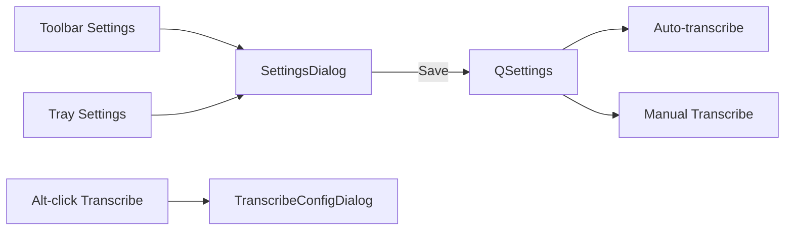

# Settings GUI

Replace the standalone Watch Folders window with one **Settings** dialog opened from the toolbar and the tray. Existing `QSettings` keys stay the source of truth; Settings is the editor for them.

## Dialog

New [`scripts/gui/settings_dialog.py`](c:/Users/pho/repos/EmotivEpoc/ACTIVE_DEV/whisper-timestamped/scripts/gui/settings_dialog.py): `QDialog` + `QTabWidget` (QSS for tabs already exists in [`style.py`](c:/Users/pho/repos/EmotivEpoc/ACTIVE_DEV/whisper-timestamped/scripts/gui/style.py)).

- **General:** Auto-transcribe completed recordings; Start with Windows (Windows only, same [`autostart.py`](c:/Users/pho/repos/EmotivEpoc/ACTIVE_DEV/whisper-timestamped/scripts/gui/autostart.py) as the tray); default scan timezone
- **Transcription:** Backend / Model / Crisper mode / default output dir (same controls as [`TranscribeConfigDialog`](c:/Users/pho/repos/EmotivEpoc/ACTIVE_DEV/whisper-timestamped/scripts/gui/dialogs.py), Save not Start)
- **Background:** Move the idle radios, delay combo, and low-priority checkbox out of Watch Folders
- **Watch folders:** Existing folder table (On / Format / Folder / Recursive, Add / Remove)

Save/Cancel. Accessors return the same shapes MainWindow already writes (`watch_folders`, `watch_run_when`, `transcribe_backend`, etc.).

Delete [`WatchFoldersDialog`](c:/Users/pho/repos/EmotivEpoc/ACTIVE_DEV/whisper-timestamped/scripts/gui/dialogs.py) after the table + background widgets live in Settings. Keep `TranscribeConfigDialog` for Alt-click runs.

## Launch points

- Toolbar: replace **Watch Folders** with **Settings** ([`_build_toolbar`](c:/Users/pho/repos/EmotivEpoc/ACTIVE_DEV/whisper-timestamped/scripts/gui/main_window.py))
- Menu bar: **Settings** with `Ctrl+,` (QMenuBar is already styled)
- Tray: replace **Watch folders…** with **Settings…** in [`tray.py`](c:/Users/pho/repos/EmotivEpoc/ACTIVE_DEV/whisper-timestamped/scripts/gui/tray.py). Keep the Auto-transcribe and Start with Windows checkboxes as shortcuts; Settings Save must `set_auto_transcribe` / `set_start_with_windows` so they stay in sync

On Save: write prefs via existing `save_prefs`, restart folder watch, update tray tooltip. Opening from tray does not have to raise the main table first; parent the dialog to `MainWindow`.

## Manual transcribe uses Settings defaults

[`_start_transcription`](c:/Users/pho/repos/EmotivEpoc/ACTIVE_DEV/whisper-timestamped/scripts/gui/main_window.py) currently treats `prompt=False` as auto (idle pause + low priority). Split that:

- `origin="manual"` | `"auto"` independent of `prompt`
- Auto drain: `prompt=False, origin="auto"`
- Toolbar / context-menu Transcribe: `origin="manual"`, `prompt=_alt_held()`

`_alt_held()` reads `QApplication.keyboardModifiers() & AltModifier`. Tooltips on Transcribe Selected / All: **Alt-click to choose backend/model for this run**. Alt-click still saves those choices as the new defaults (same as today).

Without Alt, skip `TranscribeConfigDialog` and use persisted backend/model/mode and the existing default output-dir logic (`csv_derived_output_dir` / `transcribe_output_dir`).

## Tests

Extend [`tests/test_idle_gate.py`](c:/Users/pho/repos/EmotivEpoc/ACTIVE_DEV/whisper-timestamped/tests/test_idle_gate.py) (or a small `tests/test_settings_dialog.py` with the same QApplication pattern as calendar tests):

- Settings accessors round-trip folders, run_when, idle_seconds, low_priority, backend/model/mode
- `_alt_held` helper: Alt on vs off (pass modifiers in, no live keyboard)
- Prefs Save from a Settings-shaped dict still round-trips the existing keys

Follow end-for-loop comments on new/edited `for` loops.
