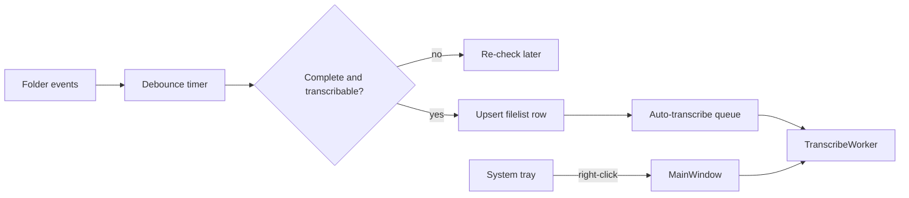

# Tray watcher for completed recordings

## Approach

Keep **one PyQt6 process**. The current GUI stays the UI; a `QSystemTrayIcon` keeps it alive in the background. Do **not** spawn a second Python/torch process (CUDA contention with the GUI).

Right-click (and double-click) shows [MainWindow](c:/Users/pho/repos/EmotivEpoc/ACTIVE_DEV/whisper-timestamped/scripts/gui/main_window.py). Left-click pops a small menu: Open, Auto-transcribe on/off, Start with Windows, Quit. Window **X** hides to tray; only **Quit** exits. `QApplication.setQuitOnLastWindowClosed(False)`.

## Completeness (do not transcribe in-progress files)

Move file-stability out of [watcher.py](c:/Users/pho/repos/EmotivEpoc/ACTIVE_DEV/whisper-timestamped/whisper_timestamped/watcher.py) into a torch-free helper, e.g. [whisper_timestamped/recording_formats/completeness.py](c:/Users/pho/repos/EmotivEpoc/ACTIVE_DEV/whisper-timestamped/whisper_timestamped/recording_formats/completeness.py). **Do not sleep on the watchdog thread** (today’s `is_stable()` sleeps 1s per event).

A path is complete when:

- It matches the watched format (`matches_file`, skip `_DUP/`, skip `.timing.json`)
- Size/mtime are unchanged across debounce ticks and mtime is at least ~10s old
- For `rec_continuous_video_recorder`: sidecar `CAM_*.mkv.timing.json` **exists and has `wall_clock_stop_unix`** (sidecar-at-start is *not* done; see [rec_continuous.py](c:/Users/pho/repos/EmotivEpoc/ACTIVE_DEV/whisper-timestamped/whisper_timestamped/recording_formats/rec_continuous.py) + continuous_video_recorder `finalize_sidecar`). No sidecar (VidGear path): size/mtime only, plus exclusive open on Windows if the handle is still held
- Optional: file size &gt; 0

Transcribable = complete **and** `find_extant_output_files` / `collect_extant_transcript_paths` finds nothing in that format’s `default_output_dir` (same skip-if-exists as [process_recordings.py](c:/Users/pho/repos/EmotivEpoc/ACTIVE_DEV/whisper-timestamped/scripts/process_recordings.py)).

Keep `whisper_timestamped_watch` as a thin CLI using the same helpers; it is not the product.

## Watch roots

Default: every registered format whose `default_recordings_dir` exists (CAM, Debut, Voice Memos, Just Press Record, iOS WhisperApp). Recursive only when `nest_one_level` is true (Just Press Record). Depth matches `discover_media()` so the watcher does not pick up files the GUI would never list.

Prefs in [preferences.py](c:/Users/pho/repos/EmotivEpoc/ACTIVE_DEV/whisper-timestamped/scripts/gui/preferences.py):

- `watch/enabled` (auto-transcribe toggle)
- `watch/folders` JSON: `{format_id, path, enabled, recursive}`
- Persist last transcribe `backend` / `model` / `crisper_mode` (unattended runs cannot pop [TranscribeConfigDialog](c:/Users/pho/repos/EmotivEpoc/ACTIVE_DEV/whisper-timestamped/scripts/gui/dialogs.py); today those are not saved)

A small **Watch folders** dialog (from the tray menu and GUI) to enable/disable those defaults and add extra dirs.

## Auto-transcribe without fighting the GUI

New [scripts/gui/folder_watch.py](c:/Users/pho/repos/EmotivEpoc/ACTIVE_DEV/whisper-timestamped/scripts/gui/folder_watch.py) (`QThread` + watchdog `Observer`):

1. Debounce create/modify (and CAM sidecar modify) into a pending set
2. On timer: completeness check; if not ready, keep pending
3. If ready: append/update one row on the format filelist CSV (`resolve_filelist_csv()` / today’s dated CSV), then enqueue `full_path`

New auto-queue on `MainWindow` (do **not** splice into an in-flight `TranscribeWorker` job list):

- If a worker is running, hold the path until `all_done`
- If idle, start `TranscribeWorker` with those rows, **no dialog**, using persisted model settings and `fmt.default_output_dir`
- Upsert the row into the loaded table when that format CSV is open so queued/transcribing/progress already works
- Tray tooltip: `Watching N folders` / `Transcribing CAM_….mkv 42%`

If the user starts a **manual** batch, auto jobs wait. Pause auto-transcribe from the tray without stopping watches.

## App lifecycle

- [main_window.py `main()`](c:/Users/pho/repos/EmotivEpoc/ACTIVE_DEV/whisper-timestamped/scripts/gui/main_window.py): always create tray; `--hidden` skips `window.show()` (used for login autostart)
- [gui_cli.py](c:/Users/pho/repos/EmotivEpoc/ACTIVE_DEV/whisper-timestamped/whisper_timestamped/gui_cli.py) + [Launch GUI.bat](c:/Users/pho/repos/EmotivEpoc/ACTIVE_DEV/whisper-timestamped/Launch GUI.bat) already forward `%*`
- Single-instance via `QLockFile` + `QLocalServer`: a second `Launch GUI.bat` raises the existing window instead of a second CUDA process
- Tray **Start with Windows**: shortcut in `%APPDATA%\Microsoft\Windows\Start Menu\Programs\Startup` targeting `Launch GUI.bat --hidden`
- Add `watchdog` to the `gui` extra in [pyproject.toml](c:/Users/pho/repos/EmotivEpoc/ACTIVE_DEV/whisper-timestamped/pyproject.toml)
- Icon: simple `QPixmap` drawn in code (repo has no `.ico`); reuse that for both window and tray

## Tests (no GUI/torch)

Add [tests/test_recording_completeness.py](c:/Users/pho/repos/EmotivEpoc/ACTIVE_DEV/whisper-timestamped/tests/test_recording_completeness.py):

- CAM sidecar without `wall_clock_stop_unix` → incomplete
- Sidecar with stop field + stable size → complete
- Growing size / young mtime → incomplete
- `_DUP/` and non-`CAM_*` names skipped
- Default watch list includes only formats whose default dir exists (temp monkeypatch)
